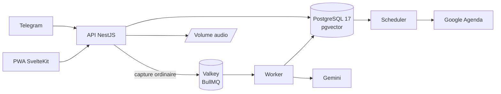
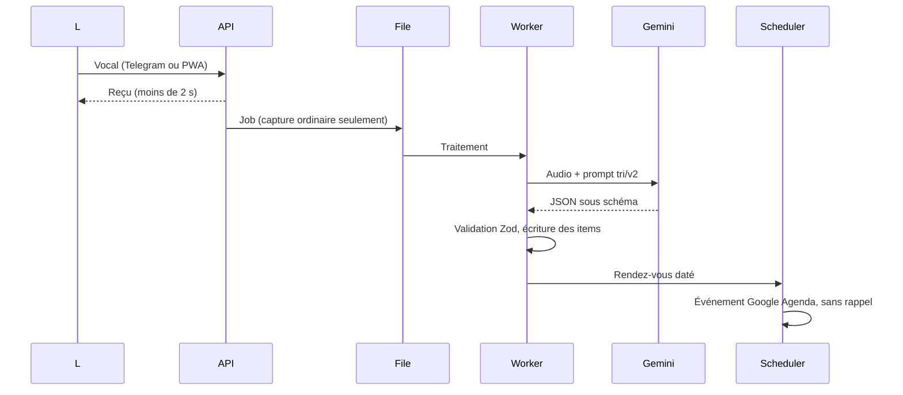

<div align="center">

# 🎙️ Organizer

**Bloc-notes vocal à tri automatique — Telegram · PWA Android · Gemini · Google Agenda**

[](CHANGELOG.md)
[](#stack-technique)
[](#licence)

*Parler d'abord, ranger plus tard : la machine trie, l'utilisatrice ne classe jamais.*

<br />

```
┌──────────────────────────────────────────────────────────────────┐
│  Organizer                                                       │
├──────────────────────────────────────────────────────────────────┤
│  Aujourd'hui · Semaine · Horizons        ◯ Appeler le garage     │
│  ───────────────────────────────         ◯ Dermato 10:00  alarme │
│  Actions cochables, sans retard          ◯ Acheter du lait       │
│                                                                  │
│  Pensées      journal par mois, filtres thème / personne         │
│  Privé        reste sur le serveur, retrouvé par date et heure   │
│  Réglages     À revoir · Historique · Effacés · Agenda           │
│                                                                  │
│  [ ●  Enregistrer          ]  [ Privé ]               0:42 / 1:30 │
└──────────────────────────────────────────────────────────────────┘
```

<br />

[Installation](#installation) ·
[Fonctionnalités](#fonctionnalités) ·
[Architecture](#architecture) ·
[Déploiement Docker](#déploiement-docker) ·
[Variables d'environnement](#variables-denvironnement) ·
[Administration](#administration)

</div>

---

## Vue d'ensemble

**Organizer** encaisse une pensée en moins de cinq secondes, puis la range sans rien demander. Un vocal part dans Telegram ou dans la PWA ; Gemini le transcrit, le découpe et le classe en un seul appel. Deux flux, jamais mélangés :

| Flux | Contenu | Restitution |
|------|---------|-------------|
| ✅ **Actions** | Rendez-vous, courses, démarches, préparatifs | Listes cochables, Google Agenda pour les rendez-vous datés |
| 💭 **Pensées** | Introspection, notes sur une relation | Journal relu, jamais coché |
| 🔒 **Privé** | Tout ce qui ne doit pas sortir | Audio seul, jamais transcrit, jamais envoyé |

Auto-hébergé sur un homelab, Android uniquement, interface en français. Deux comptes, chacun ne voit que ses données.

### Règles non négociables

- **Aucune étape avant l'enregistrement.** Le classement est différé et fait par la machine.
- **Aucune sollicitation.** Pas de rappel, pas de résumé ; une alarme ne sonne que si elle a été demandée sur cet item.
- **Zéro culpabilisation.** Ni retard, ni compteur, ni pourcentage, ni rouge.
- **Rien ne se perd.** Une capture non classable va en « À revoir », sans relance.
- **Mode privé par le point d'entrée**, jamais par le contenu : aucun chemin de code ne l'envoie à Gemini.
- **Palier payé Gemini obligatoire** : le worker vérifie la facturation au démarrage et refuse de tourner sinon.

Texte complet : [`CLAUDE.md`](CLAUDE.md) et [`docs/decisions.md`](docs/decisions.md).

---

## Fonctionnalités

### 🎤 Capture
- **Telegram** (`@mon_organizer_bot`) : vocal ou texte, accusé de réception immédiat, sans limite de durée
- **PWA** : boutons « Enregistrer » et « Privé », un appui pour démarrer, un pour arrêter ; 1 min 30 au plus (décision 26)
- Raccourcis Android sur l'icône ; file hors ligne (IndexedDB), envoi au retour du réseau
- Bouton « Prochaine capture privée » dans Telegram

### 🧠 Tri par Gemini
- Un seul appel : transcription, découpage, nature, échéance, importance, thème, personnes
- Sortie contrainte par `responseSchema`, revalidée par Zod ; repli sur le modèle supérieur
- Prompt versionné (`tri/v2` par défaut) ; chaque item garde sa version de prompt et son modèle
- Confiance basse ou date passée → « À revoir » ; `cli reclasser` rejoue une capture après un changement de prompt

### ✅ Actions
- Vues **Aujourd'hui**, **Semaine** (bande des 7 jours), **Horizons** (échéances floues)
- Cocher avec annulation ; corriger nature ou échéance en deux gestes ; réécouter l'audio et lire ce qui a été dit
- Effacer en glissant vers la gauche : confirmation, puis 5 s pour annuler

### 💭 Pensées
- Journal par mois et par jour, filtres par thème ou par personne, jamais de case à cocher
- « C'est une chose à faire » la bascule en action

### 🔒 Privé
- Écrit sur le serveur avant d'exister en base, verrouillé en SQL, jamais transcrit
- Liste par jour, heure et durée, lecteur audio, mot facultatif pour se repérer
- Audio privé jamais purgé

### 📅 Google Agenda
- Agenda dédié, portée `calendar.app.created` : l'application ne voit que ce qu'elle a créé
- Rendez-vous datés écrits **sans rappel** ; alarme 10 min avant seulement si demandée (voix, bouton du bot, interrupteur)
- Identifiant d'événement déterministe : un rejeu ne crée jamais de doublon

### 🔐 Comptes
- Mot de passe Argon2id, session de 90 jours en cookie `HttpOnly`
- Connexion par **Google** (décision 29) : l'adresse est reliée à un compte existant en ligne de commande
- Reconnexion par **empreinte** (WebAuthn, décision 23) ; le mot de passe reste possible
- Pas d'inscription : comptes créés en ligne de commande

### 💾 Sauvegarde
- Chaque nuit, base, audio (privé compris) et configuration de la stack copiés sur le NAS, dans un dossier daté
- Sept jours gardés ; fichiers inchangés en liens physiques, sans chiffrement (décision 28)
- Alerte admin si une sauvegarde échoue ou si aucune n'a réussi depuis 36 h

### ⚙️ Réglages
- À revoir, Historique des envois, Éléments effacés (avec « Remettre »), connexion de l'agenda
- Alertes techniques, pour l'admin seul ; L n'est jamais alertée
- Nouvelle version proposée par un bandeau discret et « Recharger », jamais imposée ni pendant un enregistrement (décision 27)

---

## Architecture



Une capture privée s'arrête à l'API : écrite sur le volume et en base, elle n'entre jamais dans la file.

### Flux d'une capture



---

## Stack technique

| Couche | Technologies |
|--------|--------------|
| API | NestJS 11, Node 22 LTS, grammY (bot Telegram) |
| Worker | BullMQ, API Gemini en REST (`gemini-3.1-flash-lite`, repli `gemini-3.8-flash`) |
| Scheduler | API Google Calendar v3, OAuth 2.0 |
| Front | SvelteKit 2 (Svelte 5) statique, PWA Workbox |
| Base de données | PostgreSQL 17 + pgvector, Prisma 6 |
| File | Valkey 8 |
| Serveur front | Caddy 2 |
| Sortie Internet | Squid, liste fermée de domaines |
| CI/CD | GitHub Actions → GHCR (`ghcr.io/djkix/organizer-*`) |
| Orchestration | Docker Compose, **Dockge** |

---

## Installation

### Prérequis
- **Node.js** 22 LTS et **pnpm**
- **ffmpeg** avec libopus (`brew install ffmpeg`)
- Accès SSH à l'hôte Docker du homelab (base et file de dev)
- Une clé Gemini sur un projet Google Cloud **facturé**

### Développement local

```bash
infra/dev/tunnel.sh      # à laisser ouvert : base et file de dev sur la VM
pnpm install

cp .env.example .env
# Éditer .env : DATABASE_URL et REDIS_URL pointent sur le tunnel

pnpm db migrate dev
pnpm --filter @organizer/api cli creer-utilisateur <nom> --admin
pnpm dev                 # api + worker + scheduler + web
```

Ouvrir [http://localhost:5173](http://localhost:5173) : Vite relaie `/api` vers l'API sur le port 3000.

> **Attention.** Ne jamais lancer l'API en mode `polling` avec le jeton du bot de production : deux processus se disputeraient les messages.

### Qualité & tests

```bash
pnpm test                          # migrations de test, puis Vitest
pnpm lint && pnpm typecheck
pnpm --filter @organizer/web e2e   # Playwright, API simulée
pnpm --filter @organizer/web budget  # 150 Ko compressés au plus
```

Les tests n'utilisent que des énoncés fabriqués (`fixtures/`).

---

## Déploiement Docker

La stack Dockge `organizer` vit dans `/opt/stacks/organizer/` :

- `compose.yaml` : copie de [`infra/docker-compose.yml`](infra/docker-compose.yml)
- `.env` : réglages non secrets (modèle `infra/.env.example`)
- `secrets/` : un fichier par secret, droits 600

```bash
docker compose pull
docker compose up -d --wait
```

| Service | Rôle | Sortie Internet |
|---------|------|-----------------|
| `web` | Caddy : coquille de la PWA, CSP, relais de `/api`. Seul port publié (7070) | — |
| `api` | Migrations au démarrage, puis PWA, webhook Telegram, ingestion | `api.telegram.org`, `www.googleapis.com` |
| `worker` | Classement Gemini | `generativelanguage.googleapis.com` |
| `scheduler` | Google Agenda | `www.googleapis.com`, `oauth2.googleapis.com` |
| `sortie` | Squid, seule route vers Internet | — |
| `sauvegarde` | Copie quotidienne vers le NAS (NFS) | Aucune |
| `db`, `queue` | PostgreSQL et Valkey | Aucune |

Publication par le Nginx Proxy Manager existant sur `organizer.example.org`.

### Mettre à jour

Les images suivent `latest`, publiée par la CI à chaque étiquette `v*`. Dans Dockge : **Mettre à jour**, puis vérifier `curl -s https://organizer.example.org/api/sante`.

### Revenir à une version précédente

Fixer `ORGANIZER_VERSION=<x.y.z>` dans le `.env`, puis `docker compose up -d --wait`. Une migration non additive impose de restaurer la copie de la base : voir [`docs/exploitation.md`](docs/exploitation.md#revenir-à-la-version-précédente).

---

## Variables d'environnement

| Variable | Obligatoire | Description |
|----------|-------------|-------------|
| `POSTGRES_PASSWORD` | Oui | Mot de passe PostgreSQL |
| `NPM_IP` | Oui | Adresse du Nginx Proxy Manager (proxy de confiance) |
| `IP_PUBLICATION` | Oui | Adresse de la VM où le port 7070 est publié |
| `DOMAINE_APP` | Oui | Domaine de la PWA ; l'empreinte y est liée |
| `DOMAINE_BOT` | Oui | Domaine du webhook Telegram |
| `GOOGLE_CLIENT_ID` | Oui | Client OAuth de Google Agenda (public) |
| `ORGANIZER_VERSION` | Non | Fige une version ; vide = `latest` |
| `PROMPT_VERSION` | Non | Défaut `tri/v2` |
| `GEMINI_MODEL`, `GEMINI_MODEL_FALLBACK` | Non | Modèle et repli |
| `GEMINI_TIERS_PAYES` | Non | Paliers acceptés comme payés (défaut `standard`) |
| `GEMINI_THINKING_LEVEL` | Non | Niveau de réflexion ; vide = rien demandé |

Secrets, un fichier chacun dans `secrets/` : `telegram_bot_token`, `telegram_webhook_secret`, `gemini_api_key`, `google_client_secret`, `agenda_cle`.

---

## Administration

Comptes et maintenance en ligne de commande (`docker compose exec api node apps/api/dist/cli.mjs <commande>` en production) :

| Commande | Rôle |
|----------|------|
| `creer-utilisateur <nom> [--admin]` | Crée un compte ; `--admin` reçoit les alertes |
| `mot-de-passe <nom>` | Pose ou change le mot de passe, révoque les sessions |
| `code-liaison <nom>` | Code à usage unique pour lier Telegram (`/start <code>`) |
| `lier-chat`, `delier` | Lie ou délie un chat Telegram |
| `lier-google <nom> <adresse>`, `delier-google <nom>` | Relie ou retire l'adresse Google d'un compte |
| `telegram-webhook poser\|retirer\|etat` | Gère le webhook |
| `reclasser <nom> [--essai]` | Rejoue le tri avec le prompt courant |
| `veille`, `alerte-essai`, `essai-sortie <url>` | Supervision et essais |

---

## Structure du projet

```
organizer/
├── apps/
│   ├── api/          # NestJS : bot, ingestion, aiguillage privé, REST, CLI
│   ├── worker/       # Classement Gemini, reprise, contrôle du palier payé
│   ├── scheduler/    # Google Agenda
│   └── web/          # PWA SvelteKit
├── packages/
│   ├── db/           # Schéma Prisma, migrations, garde-fous SQL du mode privé
│   └── shared/       # Types et schémas Zod
├── prompts/          # Prompts Gemini versionnés + responseSchema
├── fixtures/         # Énoncés fabriqués pour les tests
├── infra/            # docker-compose.yml, caddy/, image/, sortie/, dev/
├── design/           # Tokens et maquettes
└── docs/             # Cahier des charges, décisions, exploitation, plans
```

---

## API principale

Toutes les routes `/api` exigent une session, sauf la connexion. L'élément d'un autre compte répond `404`.

| Méthode | Route | Description |
|---------|-------|-------------|
| `GET` | `/api/sante` | Base et file joignables *(public)* |
| `POST` / `DELETE` | `/api/session` | Connexion / déconnexion |
| `POST` | `/api/session/empreinte` | Connexion par empreinte |
| `GET` / `POST` | `/api/session/google` | Identifiant du client Google / connexion par jeton Google |
| `GET` | `/api/vues/aujourdhui`, `/semaine`, `/horizons`, `/a-revoir` | Listes d'actions |
| `POST` / `DELETE` | `/api/items/:id/fait` | Cocher / décocher |
| `PATCH` / `DELETE` | `/api/items/:id` | Corriger / effacer |
| `POST` | `/api/items/:id/restaurer` | Remettre un élément effacé |
| `GET` | `/api/pensees?mois=AAAA-MM` | Journal des pensées |
| `POST` | `/api/captures` | Capture ordinaire depuis la PWA |
| `GET` | `/api/captures/:id/audio`, `/transcription` | Réécouter, lire ce qui a été dit |
| `GET` / `POST` | `/api/captures/privees` | Lister / déposer une capture privée |
| `GET` | `/api/historique?mois=AAAA-MM` | Envois non privés |
| `GET` | `/api/effaces` | Éléments effacés |
| `POST` / `GET` / `DELETE` | `/api/agenda/connexion`, `/retour`, `/api/agenda` | Google Agenda |
| `GET` | `/api/alertes` | Alertes techniques *(admin)* |
| `POST` | `/telegram/webhook` | Webhook Telegram (jeton secret vérifié) |

---

## Roadmap & périmètre actuel

**Inclus** : capture Telegram et PWA, tri Gemini, actions, pensées, privé, Google Agenda avec alarme item par item, empreinte, rotation de l'audio au-delà de 40 Go, sauvegarde quotidienne vers le NAS, Docker / Dockge.

**À venir (lot 2)** : widget Home Assistant, notifications push, fils de pensées par similarité, question de désambiguïsation dans Telegram.

**Lot 3** : recherche sémantique, apprentissage par les corrections, lecture des créneaux de l'agenda.

**Hors périmètre** (volontairement) : partage, listes collaboratives, analyse psychologique, iOS.

---

## Confidentialité et dépôt public

Le dépôt est public et l'historique Git garde tout. N'y entrent jamais : les secrets (`.env`, clés, jetons), le corpus de L (captures, transcriptions, corrections), les prénoms réels.

---

## Documentation

- [Exploitation](docs/exploitation.md) : stack, mise à jour, secrets, supervision, dépannage
- [Cahier des charges](docs/cahier-des-charges.md) : spécification complète
- [Décisions](docs/decisions.md) : décisions fermées
- [Prompts](prompts/README.md) : versions et schéma de sortie
- [Plans](docs/superpowers/plans/) : un plan par lot

---

## Historique des versions

Détail complet dans [`CHANGELOG.md`](CHANGELOG.md).

| Version | Date | Essentiel |
|---------|------|-----------|
| 1.13.0 | 2026-10-23 | Connexion par Google, à côté du mot de passe et de l'empreinte |
| 1.12.0 | 2026-10-23 | « Sauvegarder maintenant » dans Réglages, pour l'admin |
| 1.11.1 | 2026-10-23 | La sauvegarde attend l'API, délais d'attente sur la base |
| 1.11.0 | 2026-10-23 | Sauvegarde quotidienne vers le NAS, bandeau de nouvelle version |
| 1.10.0 | 2026-10-15 | Effacer un enregistrement privé, Réglages réorganisés |
| 1.9.1 | 2026-10-15 | L'API joue les migrations, plus de conteneur `migrate` |
| 1.9.0 | 2026-10-15 | Effacer une pensée, Éléments effacés avec « Remettre » |
| 1.8.x | 2026-10-15 | Prompt `tri/v2`, 1 min 30 par enregistrement, `cli reclasser`, images `latest` |
| 1.7.0 | 2026-10-08 | Alertes admin, onglet Pensées, rotation de l'audio |
| 1.6.x | 2026-10-08 | Effacement en deux temps, Historique des envois |
| 1.5.x | 2026-10-07 | Refonte « Sérénité affinée », Plus Jakarta Sans |
| 1.2.0 | 2026-10-05 | Scheduler et Google Agenda, alarme item par item |
| 1.1.0 | 2026-10-05 | Reconnexion par empreinte |
| 1.0.0 | 2026-10-04 | Mise en service |

---

## Licence

Aucune licence accordée : tous droits réservés.

---

<div align="center">

**Organizer** · v1.13.0 · Développé par [djkix](https://github.com/djkix)

</div>
